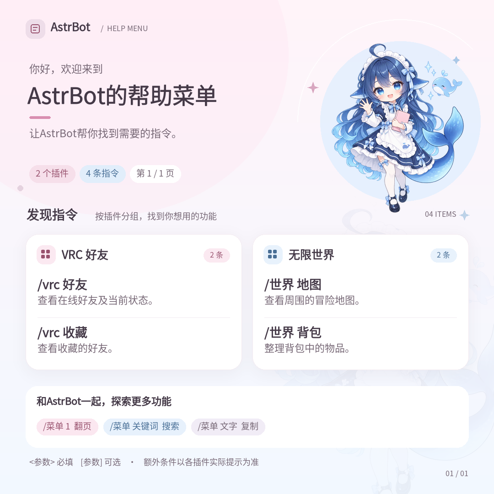

# 小鲸鱼帮助菜单

**v1.0.2 正式版** · AstrBot 通用帮助插件

自动整理当前会话可用的插件公开指令，按插件分组展示。支持图片菜单、文字版、搜索、分页、QQ OneBot 合并转发、自定义背景和额外文字说明。



## 安装

需要 AstrBot **4.13.0–4.x**、Python **3.10+**。运行依赖为 Pillow 和中文字体包 `pylopdf-fonts-zh-cn`，由 AstrBot 安装插件依赖时下载。插件包只附带插画，不附带字体二进制或生成提示词。

在 AstrBot 插件管理中选择「从链接安装」，填写：

```text
https://github.com/muyuawa/astrbot_plugin_whalehelp
```

也可以从 [Releases](https://github.com/muyuawa/astrbot_plugin_whalehelp/releases) 下载 `astrbot_plugin_whalehelp-v1.0.2.zip`，在插件管理中上传安装。手动安装时，将插件目录放入 `data/plugins/astrbot_plugin_whalehelp/`，并在 AstrBot 使用的 Python 环境安装 `requirements.txt`。

插件版本为 `1.0.2`，标识为 `astrbot_plugin_whalehelp`，可沿用已有配置和上传背景。通用功能通过 AstrBot 消息组件发送图片或文字；QQ OneBot v11 另支持合并转发，其他平台使用逐页发送。

字体依赖包约 17 MB，提供 Noto Sans SC 及字体许可。首次安装需要能访问配置的 Python 包源；安装完成后，生成菜单不联网下载字体。若手动覆盖代码后缺少字体依赖，在 AstrBot 使用的 Python 环境运行 `python -m pip install -r requirements.txt` 即可。

## 使用

| 输入示例 | 效果 |
|---|---|
| `帮助`、`help`、`菜单` | 全部页图片菜单 |
| `/帮助`、`/菜单` | 通过 AstrBot 标准指令入口调用 |
| `帮助 2` | 第二页 |
| `菜单 天气` | 搜索“天气”相关功能 |
| `帮助 文字` | 便于复制的文字菜单 |
| `帮助 文字 游戏 2` | 游戏相关文字结果第二页 |

`/` 代表当前会话配置的唤醒前缀。还支持“帮助菜单、鲸鱼帮助、菜单帮助、帮助列表、使用帮助、功能菜单、功能列表、指令、指令列表、指令菜单”，英文支持 `help`、`menu`、`commands` 及常见大小写形式。

关闭「直接发送帮助也响应」后，仅按 AstrBot 的唤醒规则调用。普通聊天中的“请帮助我写代码”和其他插件的“游戏 帮助”等不会匹配本插件的裸消息入口。

QQ OneBot v11（`aiocqhttp`）默认将全部页合并为一条聊天记录；其他平台或合并转发失败时逐页发送。指定页码只发送该页。图片生成失败的页面自动改用文字。

## 自定义菜单

在 **插件 → 小鲸鱼帮助 → 设置** 中修改，保存后下次请求生效。

### 名称与欢迎语

「机器人名称」默认 `AstrBot`，用于页头、默认标题、欢迎语和页脚。「菜单标题」和「菜单欢迎语」留空时跟随机器人名称，填写后使用自定义内容。

### 额外文字说明

「额外文字说明」可手动填写多行文字，**默认留空**。可以填写文档地址、使用提示、群规或反馈方式，例如：

```text
使用前请阅读本群规则。
功能说明：https://example.com/guide
有问题请联系管理员。
```

插件直接展示填写的内容，不内置文档地址，也不自动添加“帮助文档”等标签。留空或清空后不显示额外说明。

说明只放在本次请求的最后一页：图片自动换行并增加高度，同时在发送末尾提供可复制文字；文字菜单发送完后追加说明；合并转发放在最后一个节点。单独请求某一页时也会显示。较长的普通文字消息会分段，网址尽量保持完整。

### 自定义背景

在「自定义菜单背景图」上传一张 PNG、JPG/JPEG 或 WebP 并保存。多张时使用列表第一张，建议只保留一张竖图。

背景按每页尺寸等比例居中裁切，不拉伸。「背景淡化程度」默认 60，可在 0–100 调整：0 保留原图，100 变为纯白。页头鲸鱼娘和白色指令卡片保留；透明图片铺在白底上，JPEG 按拍摄方向校正。

删除全部背景并保存即可恢复默认粉白蓝背景。图片缺失、损坏、超过 32 MiB 或 2400 万像素时使用默认背景。上传图片位于 `data/plugin_data/astrbot_plugin_whalehelp/files/`，与插件代码分开保存。

## 隐藏与补充功能

- **隐藏整个功能（插件）**：隐藏选中插件的全部入口及别名。
- **隐藏子功能（指令组）**：隐藏选中路径及其全部子入口，相同路径按所属插件区分。
- **不在菜单展示的指令**：每行一个完整指令名，不含唤醒前缀，例如 `bili 登录`，也可匹配别名。
- **自定义简短说明**：每行 `指令=说明`，例如 `天气=查询指定城市天气`。

排除项只控制菜单展示，不修改原插件的执行权限。标准插件和指令组加载后出现在下拉框中；自定义路由在首次菜单识别后补入。

无法自动识别的公开入口可通过「补充公开功能入口」手动填写，每行：

```text
astrbot_plugin_example::roll=掷骰子
astrbot_plugin_example::游戏 帮助=查看游戏玩法
```

补充项必须属于已加载、已启用且当前会话可用的插件，只添加菜单信息，不会创建实际指令，也无法绕过已识别的管理权限、禁用状态或受限父组。

## 指令识别与缓存

每次请求读取 AstrBot 注册的命令名、别名、描述和函数签名，结合插件启用状态、会话配置、平台和群聊/私聊限制筛选。管理员查看时也使用普通用户权限，管理入口及受限父组下的子命令会被排除。

对于自行解析消息的监听器，以及只注册根指令、再在内部自行分发的插件，按需静态读取本地源码，识别明确消息分支、命令表、简单正则、分词流和可解析的本地调用链。注册信息优先，标准根指令的补充项限制在实际注册范围内。

启动和插件加载钩子不扫描源码；首次菜单按需分析，之后复用缓存。源码或相关配置变化、插件重载后重新识别。分析和图片渲染在工作线程执行，不运行目标插件业务方法、构造函数或属性 getter，不调用模型生成菜单。

动态生成、远程生成、复杂权限或无法静态解析的路由可能无法完整识别，可通过手动补充或隐藏项调整。实际执行与权限判断仍由 AstrBot 和原插件负责。

菜单图片缓存位于 `data/plugin_data/astrbot_plugin_whalehelp/menus/`。内容、说明、背景或名称变化时更新缓存，命中时不重复解码背景。超过 24 小时或多于 64 张的旧缓存会在后续渲染时清理。

## 配置一览

| 配置键 | 默认值 | 作用 |
|---|---|---|
| `bot_name` | `AstrBot` | 机器人名称 |
| `title`、`subtitle` | 留空 | 标题、欢迎语 |
| `extra_text` | 留空 | 菜单末尾的额外文字说明 |
| `background_image` | `[]` | 上传自定义背景 |
| `background_fade` | `60` | 背景淡化程度，0–100 |
| `commands_per_page` | `12` | 每页指令数，6–24 |
| `respond_to_bare_help` | `true` | 响应完整裸消息入口 |
| `auto_discover` | `true` | 按需识别自定义路由 |
| `include_builtin` | `false` | 包含内置公开指令 |
| `hidden_plugins`、`hidden_groups`、`hidden_commands` | `[]` | 排除插件、子功能或指令 |
| `extra_commands` | `[]` | 手工补充公开入口 |
| `command_descriptions` | `[]` | 覆盖指令简短说明 |

## 开发验证

仓库和安装包只保留运行文件及使用文档；[Releases](https://github.com/muyuawa/astrbot_plugin_whalehelp/releases) 的 `astrbot_plugin_whalehelp-v1.0.2-source.zip` 另含测试、开发依赖和离线检查工具。解压源码包，在其中的插件目录安装 `requirements-dev.txt` 后运行：

```bash
python -m pytest -c pyproject.toml -q
python -m ruff check --config pyproject.toml .
```

当前版本有 167 项自动化测试，并在 AstrBot 4.29.1 做过真实过滤器、加载性能及原生上传配置的离线验证。`tools/framework_check.py`、`tools/loading_check.py`、`tools/background_check.py` 和 `tools/font_install_check.py` 分别检查这些行为及依赖字体。检查不启动实际机器人或发送平台消息。

## 许可与资源来源

项目代码采用 [MIT License](LICENSE)。鲸鱼娘插画为本项目生成的装饰图，形象设计参考了[鲸鱼娘社区资产库](https://treapgogo.github.io/deepseek-whale-girl/)的蓝白女仆服、鲸鳍耳和鲸尾特征，不代表 DeepSeek 官方角色，也没有打包社区原始图片。

中文字体来自 [Noto CJK](https://github.com/notofonts/noto-cjk)，由 [pylopdf-fonts-zh-cn](https://pypi.org/project/pylopdf-fonts-zh-cn/) 依赖包提供，采用 SIL Open Font License 1.1，许可证随该依赖包安装。字体许可独立于本项目代码许可。详细来源见 [ARTWORK.md](ARTWORK.md)。
